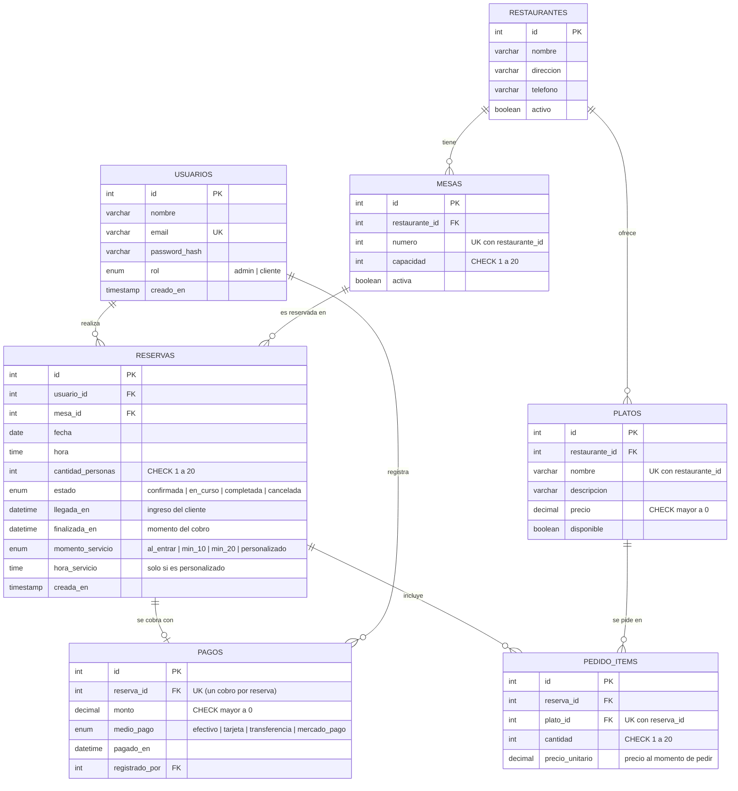

# Salón · Plataforma de reservas de restaurante

TP Final – Metodología de Sistemas II (MySQL · FastAPI · React)

## Estructura

```
reservas-app/
├── database/reservas_db.sql    Esquema (7 tablas), 5 stored procedures, datos de prueba
├── database/diagrama_er.mermaid  Diagrama entidad-relación (ver más abajo)
├── backend/                    API REST (FastAPI + aiomysql + JWT)
│   └── app/
│       ├── core/               config, pool async, seguridad JWT, dependencias, excepciones
│       ├── schemas/            validación de datos (Pydantic)
│       ├── repositories/       SQL (JOIN, GROUP BY, subconsultas, llamadas a SP)
│       ├── services/           reglas de negocio y permisos
│       └── routers/            endpoints HTTP
└── frontend/                   React + Vite
    └── src/ api/ context/ components/ pages/ utils/
```

Arquitectura en capas: **router → service → repository → MySQL**. Cada capa solo conoce a la siguiente.

## Diagrama entidad-relación

Para exportarlo como imagen (PNG/SVG) pegá el contenido de `database/diagrama_er.mermaid` en https://mermaid.live



Relaciones: un restaurante tiene muchas mesas (1:N), una mesa recibe muchas reservas (1:N), un usuario realiza muchas reservas (1:N) cada reserva tiene como máximo un pago (1:1, `pagos.reserva_id` es UNIQUE), un restaurante ofrece muchos platos (1:N) y una reserva incluye muchos ítems de pedido (1:N), cada uno referido a un plato (`pedido_items` resuelve la relación N:M entre reservas y platos). Está en 3ª forma normal: cada dato depende solo de la clave de su tabla (el nombre del restaurante no se repite en `reservas`, se obtiene con JOIN).

## Puesta en marcha

### 1) Base de datos
```bash
mysql -u root -p < database/reservas_db.sql
```

Si ya tenías la base cargada de una versión anterior, en lugar de borrarla ejecutá (en este orden, en MySQL Workbench) `database/migracion_cobros.sql` y después `database/migracion_menu.sql`. Esta última se puede correr más de una vez sin error.

### 2) Backend (Python 3.11+)
```bash
cd backend
python -m venv venv
venv\Scripts\activate          # Windows   |   source venv/bin/activate  (Linux/Mac)
pip install -r requirements.txt
copy .env.example .env         # Windows   |   cp .env.example .env  (Linux/Mac)
                               # luego editá DB_PASSWORD y JWT_SECRET
python -m scripts.cargar_passwords
uvicorn app.main:app --reload
```
API en http://localhost:8000 · documentación interactiva en http://localhost:8000/docs

### 3) Frontend (Node 18+)
```bash
cd frontend
npm install
npm run dev
```
App en http://localhost:5173

### Usuarios de prueba
| Rol | Email | Contraseña |
|---|---|---|
| Administrador | admin@claudia.com | Admin1234 |
| Cliente | lucia@mail.com | Cliente1234 |

## Cumplimiento de la consigna

| Requisito | Dónde está |
|---|---|
| Modelo entidad-relación | `database/diagrama_er.mermaid` (diagrama abajo) |
| ≥ 4 tablas normalizadas con PK/FK | `usuarios`, `restaurantes`, `mesas`, `reservas`, `pagos`, `platos`, `pedido_items` |
| Constraints | `UNIQUE`, `CHECK`, `ENUM`, `FOREIGN KEY` con `ON DELETE/UPDATE` |
| Stored procedure con parámetros, COMMIT y ROLLBACK | `sp_crear_reserva`, `sp_modificar_reserva`, `sp_registrar_llegada`, `sp_cobrar_reserva` y `sp_guardar_pedido` (recibe un JSON) |
| CRUD | Usuarios, restaurantes, mesas, platos del menú y reservas |
| ≥ 3 consultas con JOIN / subconsultas / GROUP BY | `repositories/reservas.py` (JOIN de 4 tablas), `repositories/reportes.py` (GROUP BY, HAVING + subconsulta), `repositories/mesas.py` (NOT IN + subconsulta), `repositories/reservas.py` (subconsulta con SUM para el total del pedido) y `repositories/pedidos.py` (SUM) |
| Conexión asíncrona | `aiomysql` con pool, endpoints `async def` |
| JWT | `core/security.py`, `core/deps.py`; roles admin y cliente |
| Formularios con validación | Todas las páginas, reglas en `utils/validators.js` |
| Tablas y dashboard | `pages/Dashboard.jsx` y tablas en cada módulo |
| Reportes PDF / Excel | `pages/Reportes.jsx` + `utils/exporters.js` (incluye pagos e ingresos por medio de pago) |
| Validación en cliente y servidor | `validators.js` (cliente) y Pydantic (servidor) |
| Separación en capas | Ver estructura de arriba |

## Ciclo de vida de la reserva y estado de las mesas

```
confirmada --(llega el cliente)--> en_curso --(paga)--> completada
confirmada --(se cancela)--------> cancelada
```

- **Ingreso del cliente:** el administrador toca **Llegó** en *Reservas*. Se guarda la hora de ingreso (`llegada_en`) y la mesa pasa a **Ocupada**.
- **Ingreso del dinero:** el administrador toca **Cobrar y liberar**, carga monto y medio de pago. `sp_cobrar_reserva` guarda el pago y cierra la reserva en una sola transacción, y la mesa pasa a **Libre en ese mismo instante**, hayan pasado 2 horas o no.
- **No hay tope de duración:** una mesa sigue ocupada hasta que se cobra. Las 2 horas (`fn_minutos_estimados`) se usan solo para no agendar dos reservas casi pegadas en la misma mesa a futuro.
- **Mesas en vivo** (solo administrador): libres, ocupadas y reservadas de hoy; se actualiza sola cada 15 segundos.
- El **Panel** muestra mesas ocupadas ahora y cobrado hoy.

### Cómo probarlo (para el docente)
1. Entrar como cliente (`lucia@mail.com` / `Cliente1234`) y crear una reserva para **hoy** en un horario futuro (12:00 a 23:30).
2. Entrar como administrador (`admin@claudia.com` / `Admin1234`). En *Reservas* tocar **Llegó**: pasa a *En curso*.
3. En *Mesas en vivo* esa mesa figura **Ocupada**.
4. Tocar **Cobrar y liberar**, cargar monto y medio de pago.
5. La mesa figura **Libre** de inmediato y el pago aparece en *Reportes > Pagos registrados*.

Probar el menú: como cliente, en *Nueva reserva* elegir restaurante y platos y confirmar; aparece el cartel con el total y las opciones de horario. Como administrador, en *Menú* se gestionan los platos y en *Reservas* se ve la columna *Pedido*.

## Menú y pedido de comida

- **Administrador:** en *Menú* carga, edita y elimina platos con su precio y los marca como disponibles o no. Un plato ya pedido no se puede eliminar (queda registrado).
- **Cliente:** al reservar, después de elegir el restaurante ve su menú con los precios, elige las cantidades (opcional) y ve en vivo **cuánto va a pagar**. También puede consultar el *Menú* aparte.
- **Carteles al reservar:**
  - Sin comida: **"Reservado con éxito"** y **"Lo estaremos esperando"**.
  - Con comida: **"Reservado con éxito"** y **"Su comida será servida en el horario que el anfitrión decida"**, con el total a pagar y las opciones *En el momento que entró al restaurante*, *10 minutos después de entrar al restaurante*, *20 minutos después de entrar al restaurante* y *Personalizado* (el cliente elige la hora). Al confirmar muestra **"Finalizado con éxito"**. Si prefiere, toca *Que decida el anfitrión*.
- **En el local:** el administrador puede agregar o cambiar la comida de una reserva (*Pedir comida* / *Pedido*), también cuando el cliente ya está en la mesa. Al tocar *Cobrar* el monto ya viene cargado con el total del pedido (se puede ajustar, por ejemplo por propina).
- **Pedidos de hoy (administrador):** pantalla con una tarjeta por mesa que muestra los platos a servir, el cliente, el total y la **hora exacta de servicio** (por ejemplo, si llegó a las 19:51 y eligió *10 minutos después*, dice *Servir a las 20:01*). Si el cliente todavía no llegó, la hora se calcula cuando se toca *Llegó*. Desde ahí también se marca la llegada y se cobra. Se actualiza sola cada 15 segundos.
- **Reglas:** los platos tienen que ser del restaurante de la reserva y estar disponibles; el pedido se guarda con el precio vigente al momento de pedir (`pedido_items.precio_unitario`); si la reserva se cambia a otro restaurante, el pedido se descarta; el horario *Personalizado* no puede ser anterior a la hora de la reserva.
- **Endpoints:** `GET/POST/PUT/DELETE /platos`, `GET/PUT /reservas/{id}/pedido`, `PATCH /reservas/{id}/servicio`, `GET /pedidos/hoy` (administrador).

## Flujo JWT
1. `POST /auth/login` valida la contraseña (bcrypt) y devuelve un token firmado (HS256) con id, rol y vencimiento.
2. El frontend lo guarda y `api/client.js` lo envía en `Authorization: Bearer <token>`.
3. `get_current_user` verifica firma y vencimiento en cada petición; `require_admin` restringe por rol.
4. Si el token vence, el backend responde 401 y el frontend cierra la sesión.

## Qué decir en la defensa
- **¿Por qué `FOR UPDATE` en el SP?** Bloquea la fila de la mesa mientras dura la transacción. Sin eso, dos clientes simultáneos podrían leer "mesa libre" y reservar a la vez.
- **¿Por qué un stored procedure y no código Python?** La regla de no superposición vive junto a los datos y es atómica: si algo falla, `ROLLBACK` y no queda nada a medias.
- **¿Qué pasa si se cae la conexión a mitad del SP?** MySQL deshace automáticamente la transacción abierta.
- **¿Por qué async?** Mientras una consulta espera a MySQL, el servidor atiende otras peticiones en lugar de bloquearse.
- **¿Por qué mismo mensaje para email inexistente y clave mala?** Para no revelar qué emails están registrados.
- **¿Por qué validar en cliente y servidor?** El cliente da feedback inmediato; el servidor es la única validación confiable.
